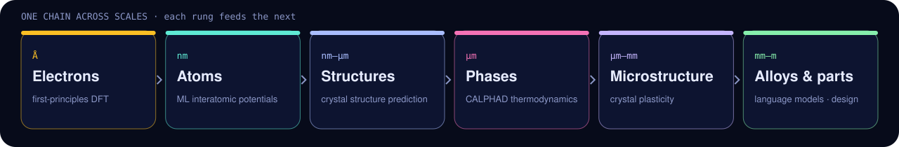
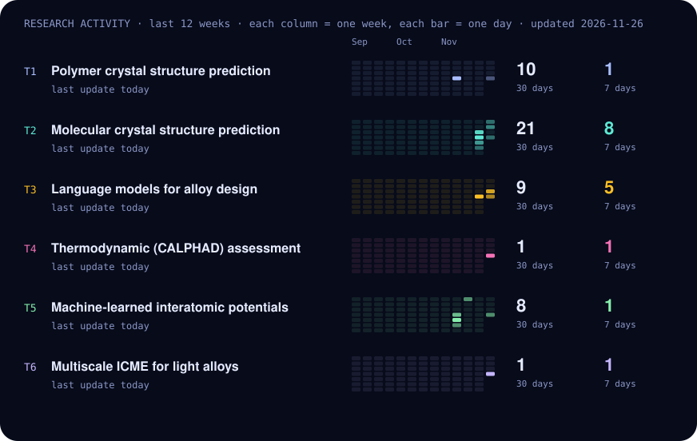

  

  
  
  

  <b>Discovery2Scale (D2S) builds the computational chain from quantum mechanics to engineered materials.</b> 
  First-principles calculations, machine-learned interatomic potentials, language models trained on the materials literature,
  CALPHAD thermodynamics and crystal plasticity, connected so a materials question can be answered at the scale where it matters.

 

## 🧭 What we work on

  

## 📈 Live research activity

  

Updated automatically every day from our private repositories. Code and project details stay internal; only activity counts are shown here.

| Track | Focus | Last update | Commits (30 d) |
|:--|:--|:--|--:|
| `T1` | Polymer crystal structure prediction | today | 12 |
| `T2` | Molecular crystal structure prediction | yesterday | 21 |
| `T3` | Language models for alloy design | today | 11 |
| `T4` | Thermodynamic (CALPHAD) assessment | yesterday | 1 |
| `T5` | Machine-learned interatomic potentials | yesterday | 8 |
| `T6` | Multiscale ICME for light alloys | today | 3 |

## 🛠️ Toolbox

  
  
  
  
  
  
  
  

## 🔒 About our code

Our research code lives in private repositories inside this organization. If you would like to collaborate or learn more about
our work, please reach out to the team.

  Discovery2Scale · D2S-Labs · profile refreshed 2026-11-27

